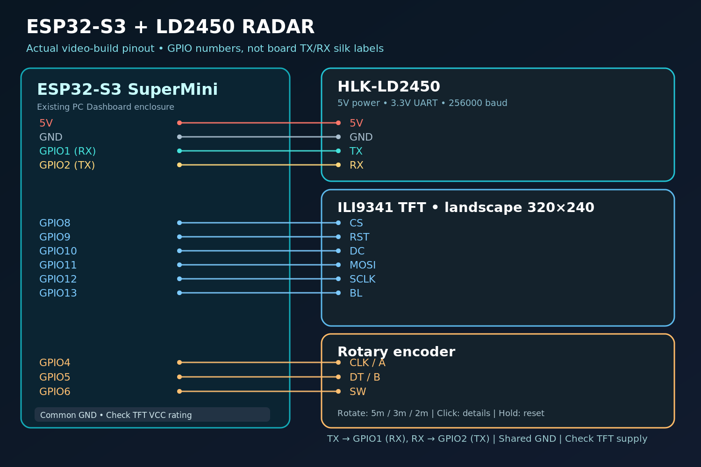

# ESP32-S3 + LD2450 Multi-Target Radar 📡

**A real-time, camera-free radar tracker with an ESP32-S3, a 2.4-inch ILI9341 TFT, and a rotary encoder.** Built by **InnoCircuitsLab**.

The **HLK-LD2450 24 GHz mmWave radar** reports the X/Y position and radial speed of **up to 3 detected targets**. The ESP32-S3 converts this UART data into a live radar map and a target-details page.

> **This repository includes the original `Radar_UI_V3.ino` sketch used in the project/video.** The existing ESP32-S3 PC Dashboard screen and encoder wiring was retained; only the external LD2450 UART connection was added.



## What it does

- 📡 **Live RADAR view:** positions up to 3 targets on a top-down map.
- 🎛️ **Rotary encoder zoom:** rotate between **5 m, 3 m and 2 m** *display scales* (not new sensor detection-range settings).
- 🖱️ **Short encoder press:** switch between **RADAR** and **TARGET DATA** views.
- ↩️ **Long press (~1.2 s):** return to RADAR view and reset the display scale to **5 m**.
- 📍 **Details view:** X and Y in **mm**, planar distance in **m**, speed in **cm/s**.
- 🟢 **LIVE/WAIT** status; **framebuffer drawing** reduces flicker.
- 📲 **HLKRadarTool** Bluetooth app can independently visualize and enable the radar module's **multi-target mode**.

## Hardware

| Part | Notes |
| --- | --- |
| ESP32-S3 SuperMini | ESP32-S3 with Arduino ESP32 board support |
| HLK-LD2450 radar module | **5 V supply**, **3.3 V UART logic**, **256000 baud** |
| 2.4-inch SPI TFT | ILI9341 controller, native **240×320**, used landscape **320×240** |
| Rotary encoder + push button | CLK/DT/SW, e.g. common mechanical encoder module |
| USB power, jumper wires | Shared GND between all modules |
| Small 3D-printed stand (optional) | Holds radar upright and aimed at the detection area |

### Wiring — **same GPIO assignments as the actual build**

**LD2450 ↔ ESP32-S3:**

| LD2450 pin | ESP32-S3 pin | Notes |
| --- | --- | --- |
| `5V` | `5V` | Supply capable of providing the LD2450's required current |
| `GND` | `GND` | Common ground |
| `TX` | **`GPIO1`** (radar RX) | **Cross TX to RX** |
| `RX` | **`GPIO2`** (radar TX) | **Cross RX to TX** |

**ILI9341 TFT ↔ ESP32-S3:**

| TFT connection | ESP32-S3 GPIO |
| --- | ---: |
| `CS` | `GPIO8` |
| `RST/RESET` | `GPIO9` |
| `DC/RS` | `GPIO10` |
| `MOSI/SDA/DIN` | `GPIO11` |
| `SCLK/SCK/CLK` | `GPIO12` |
| `LED/BL` | `GPIO13` (existing build) |
| `VCC` | Supply appropriate for **your particular TFT module** |
| `GND` | `GND` |

`MISO` is not used by this sketch. The TFT supply pin differs among module carrier boards (some boards include voltage regulators, some do not). **Check your own module's power rating; do not assume its VCC pin accepts 5 V.**

**Rotary encoder ↔ ESP32-S3:**

| Encoder | ESP32-S3 GPIO |
| --- | ---: |
| `CLK / A` | `GPIO4` |
| `DT / B` | `GPIO5` |
| `SW` | `GPIO6` |
| `+ / VCC` (if present) | `3V3` |
| `GND` | `GND` |

The sketch enables internal pull-ups on `GPIO4/5/6`. The **on-board pins labeled `TX` and `RX` are not automatically GPIO1 and GPIO2** on this ESP32-S3 SuperMini. One of our real test failures was connecting to the board's `TX/RX` labels instead of the **GPIO1/GPIO2** used in the code. The screen started but received no target data; correcting the wiring fixed it.

➡️ See the [full wiring guide](docs/WIRING.md) and [SVG diagram](assets/wiring-diagram.svg).

## Get started (Arduino IDE)

1. Install **Arduino IDE 2.x**.
2. In **Boards Manager**, install **`esp32` by Espressif Systems**.
3. In **Library Manager**, install **`Adafruit GFX Library`** and **`Adafruit ILI9341`** (install any dependencies the IDE requests).
4. Select your **ESP32-S3 board** (typically **ESP32S3 Dev Module** for a compatible generic SuperMini); select the correct USB port. Your particular board may require different USB/CDC upload options.
5. Open [`firmware/Radar_UI_V3/Radar_UI_V3.ino`](firmware/Radar_UI_V3/Radar_UI_V3.ino).
6. Wire the modules **exactly as shown above**; verify TX/RX crossing and power polarity.
7. Click **Upload**. Open the **Serial Monitor at 115200 baud** if you want simple status messages.
8. Rotate the encoder to zoom, short-click for detail page, or long-press to reset.

**Two different baud rates are intentional:** The ESP32 USB Serial Monitor is `115200` baud, while the ESP32 ↔ LD2450 UART link is **`256000`** baud.

### Screen and controls

| Action | Result |
| --- | --- |
| Power on | RADAR view, **5 m display scale** |
| Rotate one direction | Zoom in: **5 → 3 → 2 m** |
| Rotate reverse direction | Zoom out: **2 → 3 → 5 m** |
| Short-press encoder | RADAR ↔ TARGET DATA |
| Hold encoder for ~1.2 s | Reset **5 m** and return to RADAR |

The **2/3/5 m setting changes only the TFT map scale**; it does **not** reconfigure the LD2450's RF detection range. `T1`, `T2` and `T3` are **target slots**, not permanent identities of individual people.

## Enable/test multi-target mode with your phone

The radar module has its **own Bluetooth interface**. You do **not** need to pair with the ESP32-S3 or write a phone app.

1. Power the **HLK-LD2450**, and keep the smartphone close to the radar module.
2. Install **HLKRadarTool** from Hi-Link's [official app download page](https://www.hlktech.com/Mobile/App/12.html) (includes iOS/Android), or [Apple App Store](https://apps.apple.com/us/app/hlkradartool/id1638651152).
3. Enable Bluetooth and allow the requested Bluetooth permissions in the phone's settings.
4. Open **HLKRadarTool**, scan for a name like **`HLK-LD2450_XXXX`**, and connect.
5. Open the module's radar/detection page (with the fan-shaped plot). Look for the **`Multi-person` / `Multi-target`** toggle (some app translations show **多人**). **Turn it ON**.
6. Leave the UART baud rate at **`256000`**, which matches the included sketch.
7. Stand two people in front of the radar, sufficiently separated and moving. Check that the app's target display shows **Target 1 / Target 2** and that the ESP32 screen also reports two targets. The module can report up to **three** in suitable conditions.
8. If your app does not expose the mode toggle, check the app/firmware version and read [docs/HLKRadarTool-Multi-Target.md](docs/HLKRadarTool-Multi-Target.md) before attempting any firmware update.

The phone app is for **configuring and testing the LD2450 itself**; the TFT still receives tracking data **directly over UART** from the module. App appearance and labels can vary by version.

## Files

```text
ESP32-S3-LD2450-Multi-Target-Radar/
├── README.md
├── LICENSE
├── firmware/
│   └── Radar_UI_V3/
│       └── Radar_UI_V3.ino            # Original final sketch used in the build
├── extras/
│   └── LD2450_Serial_Debug/
│       └── LD2450_Serial_Debug.ino   # Optional independent UART test
├── docs/
│   ├── WIRING.md
│   ├── HLKRadarTool-Multi-Target.md
│   ├── HOW-IT-WORKS.md
│   └── TROUBLESHOOTING.md
└── assets/
    ├── wiring-diagram.svg
    ├── wiring-diagram.png
    └── mobile-app-flow.svg
```

## Testing and limitations

- In our practical tests, **one- and two-person tracking worked**. Mounting height and orientation strongly affected detection; improving the sensor's position helped us track a second person.
- People moving behind a **closed wooden door** were sometimes detected in our setup. This is **not** a guarantee of reliable detection through doors or walls. RF material attenuation and multipath/reflections matter.
- A shorter target was missed under one mounting configuration and detected after adjusting the sensor. **This is not a minimum-height specification.**
- The display's distance is calculated as `sqrt(X²+Y²)` from the reported **2D sensor-relative coordinates**; it is an estimate, not a certified position measurement.
- The original sketch smooths **only the displayed X/Y positions** and buffers each full screen frame to reduce visible flicker. Smoothing does not increase measurement accuracy.
- Target slots may be reassigned. This project is **not a safety-critical people detector**, and it does not identify people or capture images.
- This is a **local, offline ESP32 radar display**. Wi-Fi and cloud services are not required for the display.

## References

- [Hi-Link official HLK-LD2450 user tutorial (PDF, Chinese)](https://h.hlktech.com/download/HLK-LD2450-24G/1/HLK-LD2450%E4%BD%BF%E7%94%A8%E6%95%99%E7%A8%8BV1.1.pdf)
- [Hi-Link LD2450 manual / electrical specifications (PDF)](https://h.hlktech.com/download/HLK-LD2450-24G/1/HLK%20LD2450%201T2R%E8%BF%90%E5%8A%A8%E7%9B%AE%E6%A0%87%E6%A3%80%E6%B5%8B%E8%BF%BD%E8%B8%AA%E6%A8%A1%E7%BB%84%E8%AF%B4%E6%98%8E%E4%B9%A6%20V1.02%20.pdf)
- [Official LD2450 serial protocol (PDF)](https://h.hlktech.com/download/HLK-LD2450-24G/1/LD2450%20%E4%B8%B2%E5%8F%A3%E9%80%9A%E4%BF%A1%E5%8D%8F%E8%AE%AE%20V1.03.pdf)
- [Hi-Link official HLKRadarTool download](https://www.hlktech.com/Mobile/App/12.html)

## License

MIT License — see [LICENSE](LICENSE).
