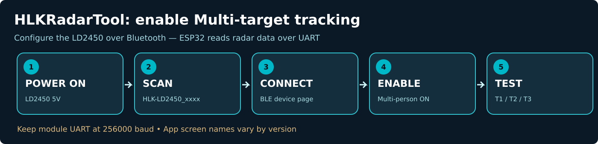

# Enable LD2450 multi-target mode in the HLKRadarTool phone app

The **LD2450 has a Bluetooth interface of its own**. The app talks to the radar module, **not to the ESP32-S3**; the ESP32 display receives UART frames independently.

## Install

- [Official Hi-Link HLKRadarTool download (Android / iOS)](https://www.hlktech.com/Mobile/App/12.html)
- [Apple App Store – HLKRadarTool](https://apps.apple.com/us/app/hlkradartool/id1638651152)
- [Official Hi-Link LD2450 phone app tutorial (PDF)](https://h.hlktech.com/download/HLK-LD2450-24G/1/HLK-LD2450%E4%BD%BF%E7%94%A8%E6%95%99%E7%A8%8BV1.1.pdf)

## Step-by-step

1. **Power the LD2450** and turn on Bluetooth on your phone. Stay close to the module; Bluetooth range may be limited by its antenna and installation.
2. **Open HLKRadarTool**, allow Bluetooth permissions, and start the device scan.
3. **Select your radar** from the nearby devices list. The name is typically `HLK-LD2450_XXXX` (the last characters differ for each unit).
4. On the radar's device page, find the **fan-shaped live detection plot**, target readouts and module settings.
5. Find the **`Multi-person` / `Multi-target`** switch (Chinese **`多人`** in Hi-Link's manual). **Turn it ON**. With this enabled, the module can report up to **three target slots** in suitable conditions.
6. Verify that the **baud rate stays `256000`**. Changing it can break UART parsing in `Radar_UI_V3.ino`; if you change it, adjust the sketch or set it back and restart the module.
7. Test with **two people** at different positions. Give them some separation, face the sensor toward their motion, and avoid metal obstacles directly in front of the radar.
8. Compare the app's live targets with the ESP32 TFT/Serial Monitor readings.

### Firmware / app version

The user's radar was observed running firmware **`V2.04.23101915`** while multi-target tracking was tested. Historical support for multi-target mode started around **LD2450 firmware `V2.02.23090617`** and **HLKRadarTool app `V1.4.0`**. If the switch is missing, update the *phone app first*. Firmware updates are optional and potentially disruptive; note your current version and check official release details before updating. The official manual explicitly says older firmware may expose only OTA in the phone app.

### Troubleshooting the app

- **Module not found:** bring the phone near the radar; confirm it is powered and Bluetooth is enabled. Some modules have a separate BT antenna/connector; check it if your variant includes one.
- **Only one person shows:** confirm **Multi-person ON**, then try separating the subjects and adjusting radar mounting height/aim; detection depends on motion and geometry.
- **ESP32 stopped receiving data after app changes:** verify UART is still `256000` and **TX/RX** are crossed as in [WIRING.md](WIRING.md).
- **No settings, only firmware update shown:** consult Hi-Link's instructions; an older sensor firmware may not support the richer settings interface.

This is a **third-party manufacturer utility**. Screens, menu names and update flows may change between versions. Do not treat target numbers as fixed human identities.
