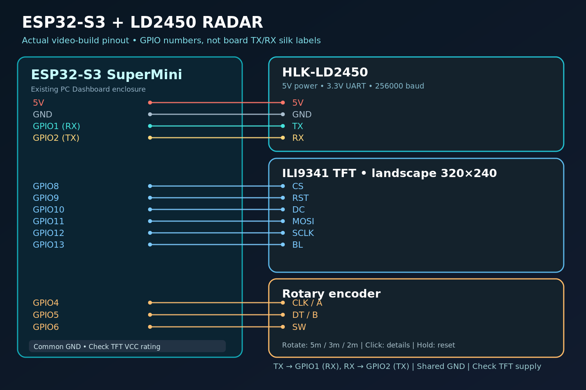

# Wiring — same pins as the InnoCircuitsLab build

This is the **ESP32-S3 SuperMini inside an existing PC Dashboard enclosure**. The ILI9341 and encoder connections were already in place; the **LD2450 adds four wires**. **Pin labels on other ESP32-S3 boards can differ.** Always use the actual GPIO number, not an assumed location.

## LD2450 radar (4 wires)

| Pin on LD2450 | Connect to ESP32-S3 | Purpose |
|---|---|---|
| `5V` | `5V` | Module is 5 V powered, rated source capacity >200 mA |
| `GND` | `GND` | Shared ground |
| `TX` | `GPIO1` | ESP32 receives radar data |
| `RX` | `GPIO2` | ESP32 transmits UART commands (sketch primarily listens) |

**Do not connect LD2450's `5V` to ESP32-S3 `3V3`.** UART logic uses 3.3 V. Never connect 5 V directly to ESP32-S3 GPIOs.

### Why did the display show no targets in the first test?

Our initial wiring used pins labeled `TX/RX` on the development board, whereas the sketch was listening on **GPIO1/GPIO2**. The display initialized normally, but radar frames did not arrive. Connecting **LD2450 TX → GPIO1** and **LD2450 RX → GPIO2** fixed it.

## SPI display: 2.4" ILI9341, 240×320 hardware, 320×240 landscape

| Display label | ESP32-S3 |
|---|---|
| `CS` | `GPIO8` |
| `RST` | `GPIO9` |
| `DC / RS` | `GPIO10` |
| `MOSI / SDA / SDI` | `GPIO11` |
| `SCK / SCLK / CLK` | `GPIO12` |
| `LED / BL` | `GPIO13` |
| `GND` | `GND` |
| `VCC` | Power rating on your module (typically 3.3 V for unregulated 3.3 V modules) |

The sketch uses write-only SPI (`MISO` not needed). Check whether **your TFT carrier** is rated for 3.3 V or includes its own regulator before choosing `VCC`. Backlight control was wired and tested with GPIO13 **in this build**; do not drive an unknown high-current backlight directly without checking the module's circuit.

## Rotary encoder

| Encoder label | ESP32-S3 |
|---|---|
| `CLK / A` | `GPIO4` |
| `DT / B` | `GPIO5` |
| `SW` | `GPIO6` |
| `GND` | `GND` |
| `VCC / +` (if needed) | `3V3` |

The sketch uses `INPUT_PULLUP`. Encoder direction and the transitions-per-detent vary by encoder; the V3 source has a comment explaining how to reverse direction and adjust `ENC_STEPS` if your module differs.

## UART / serial settings

- Radar → ESP32 `HardwareSerial(1)`: **256000 baud**, 8N1, RX=GPIO1, TX=GPIO2.
- Arduino Serial Monitor over USB: **115200 baud**.
- Sensor report: **30-byte** packet with header `AA FF 03 00`, three 8-byte target slots, footer `55 CC`.

## Bench assembly checks

1. Unplug USB before moving any conductors.
2. Verify power pin orientation on the *specific* LD2450 module/connector.
3. Confirm common GND.
4. Confirm **LD2450 TX → ESP32 GPIO1 (RX)**, not TX-to-TX.
5. Power the device; the TFT should show `LIVE` after valid packets arrive.
6. If you get `WAIT`, check the wires, power, baud and multi-target app settings.
